# 🏎️ F1 Data Science

[](https://github.com/pdf1802/f1-data-science/actions/workflows/tests.yml)
[](https://docs.astral.sh/ruff/)
[](https://www.python.org/downloads/)
[](https://opensource.org/licenses/MIT)
[](https://github.com/theOehrly/Fast-F1)

<!-- LIVE DEMO: once the dashboard is deployed (docs/DEPLOY.md), put the link here, e.g.
**▶ Live demo: https://YOUR-APP.streamlit.app** -->

An end-to-end **Formula 1 race strategy system** built as a teaching portfolio. It trains **science modules** on real FastF1 lap data (2022–2025), composes them into a **lap-by-lap race engine** that is backtested against 36 real races, and puts that engine on the pit wall: a **Streamlit dashboard** of strategy tools and a live **Race Engineer** that makes the box / stay-out call while a race replays in [f1-race-replay](https://github.com/IAmTomShaw/f1-race-replay) — and a **TAKE CONTROL** button that hands the race to the engine at any lap, with the cars drawn on the real circuit.

The project is structured as a curriculum: each module teaches one ML/statistics concept (XGBoost regression and classification, fixed-effects regression, hierarchical models and shrinkage, Bayesian updating, clustering, paired Monte Carlo) and each tool shows how the models compose into something useful. Every number below was re-run for this README; the limitations section is part of the project, not an afterthought.

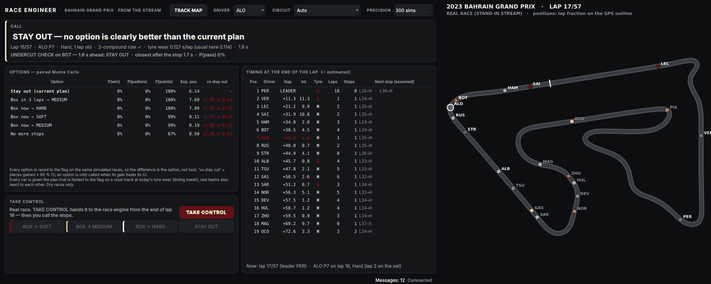
*Bahrain 2023 replays lap by lap; on lap 19 **TAKE CONTROL** hands the race to the engine, Alonso is boxed onto HARDs with a button, and the Race Engineer keeps making the call. Right: the same moment on the circuit.*

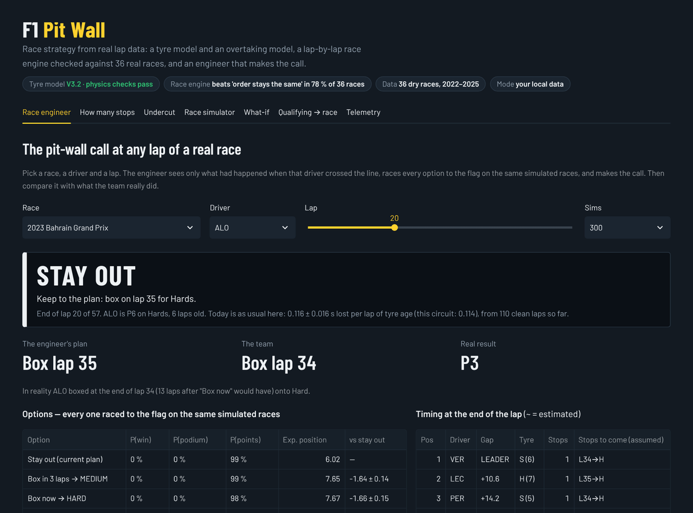
*The dashboard. It runs on a fresh clone: `demo/` ships the data and models it needs.*

---

## 📚 Curriculum

### Science modules

| # | Notebook | Concept | Output |
|---|----------|---------|--------|
| **0** | [`tyre_degradation.ipynb`](notebooks/tyre_degradation.ipynb) | Exploratory data analysis | The data cleaning + degradation patterns that justify Module 1 |
| **1** | [`lap_time_model.ipynb`](notebooks/lap_time_model.ipynb) | XGBoost regression + fixed-effects reference | `LapDelta` from compound, tyre age, circuit and the race's degradation rate (V3.2: fuel-corrected, clean air, dry races, physics gate) |
| **1b** | [`degradation_by_circuit.ipynb`](notebooks/degradation_by_circuit.ipynb) | Hierarchical model, shrinkage, Bayesian updating, validating a decision | How hard each race is on tyres: measured per race, a prior per circuit, a live estimate during the race |
| **2** | [`overtaking_model.ipynb`](notebooks/overtaking_model.ipynb) | XGBoost classification, calibrated | P(pass the car ahead this lap) from the real gap, tyres, lap, position, circuit |
| **3** | [`driver_style_fingerprinting.ipynb`](notebooks/driver_style_fingerprinting.ipynb) | Telemetry resampling + KMeans | Driver style signature (5 features → 4 clusters, V2) |

### Strategy tools (dashboard tabs and notebooks)

Each notebook walks through the tool step by step, shows the **real source** from `tools/` (no second copy of the code) and validates it on real races — executed, outputs included.

| # | Notebook | Question | Uses | Validated on |
|---|----------|----------|------|--------------|
| **1** | [`undercut_calculator.ipynb`](notebooks/undercut_calculator.ipynb) | Will the undercut actually work right now? | M1, M2 | 101 real undercut attempts the leader answered within 3 laps |
| **2** | [`stint_optimizer.ipynb`](notebooks/stint_optimizer.ipynb) | How many stops, and when? | M1 | 193 real one-stops in 25 races; one stop vs two in 36 races |
| **3** | [`race_simulator.ipynb`](notebooks/race_simulator.ipynb) | How does the race play out lap by lap? | M1, M2, engine | 20 races from the grid, real strategies |
| **4** | [`qualy_predictor.ipynb`](notebooks/qualy_predictor.ipynb) | Is pole pace real race pace? | M1 | 20 races vs qualifying order |
| **5** | [`what_if_simulator.ipynb`](notebooks/what_if_simulator.ipynb) | Same races, different strategy: what changes? | M1, M2, engine | paired vs unpaired comparison (CRN) |
| **6** | [`telemetry_clash.ipynb`](notebooks/telemetry_clash.ipynb) | Who gains in which corners? | signal processing | official lap-time difference; per-corner alignment error |

### Race engine and live tools

| Piece | File | What it does |
|-------|------|--------------|
| Circuit profiles | [`tools/circuit_profiles.py`](tools/circuit_profiles.py) | Laps, typical lap, **pit loss measured from real green-flag stops** (Monaco 19 s … Singapore 27 s), Safety Car rate with empirical-Bayes shrinkage |
| Degradation | [`tools/degradation.py`](tools/degradation.py) | Tyre degradation rate **per race** (driver fixed effects, bootstrap by driver), a shrunk prior per circuit, and a calibrated in-race update |
| Race engine | [`tools/race_engine.py`](tools/race_engine.py) | Race state for S simulations × D drivers and a `step()` that advances one lap; starts from the grid or from **any lap of a real race**, using only that race's laps up to that point; each simulation draws its own "how hard is today on tyres" |
| Backtest | [`tools/backtest.py`](tools/backtest.py) | From 40 % distance in 36 real races, does the engine predict the finishing order better than "the order stays the same"? And one stop or two — vs what the field did (`--stops`) |
| Race Engineer | [`tools/race_engineer.py`](tools/race_engineer.py) | Live feed → strategy call for one driver at most once per lap: options raced to the flag on the same random draws; every car on its fastest plan at today's degradation |
| Pit-wall window | [`integrations/f1_race_replay/`](integrations/f1_race_replay/README.md) | PySide6 window on f1-race-replay's telemetry stream; stand-in stream from the lap data; **TAKE CONTROL button** |
| Track view | [`track_view.py`](integrations/f1_race_replay/track_view.py), [`tools/circuit_outlines.py`](tools/circuit_outlines.py) | The race drawn on the real circuit (GPS outlines of 12 circuits from the cache), live — also in take-control |
| Real replay, offline | [`run_real_replay.py`](integrations/f1_race_replay/run_real_replay.py), [`real_payloads.py`](integrations/f1_race_replay/real_payloads.py) | f1-race-replay on a cached race without the internet; its real payloads captured to validate the engineer |
| Demo bundle | [`tools/demo_data.py`](tools/demo_data.py), [`demo/`](demo/) | The data and models the dashboard needs (≈ 4 MB), so it runs on a fresh clone and on a free host |

---

## 🚀 Quick Start

```bash
git clone https://github.com/pdf1802/f1-data-science.git
cd f1-data-science
pip install -r requirements.txt
streamlit run app.py              # works at once: demo/ ships the lap data, the models and a few sessions
```

For everything else (Race Engineer window, notebooks, tests, lint):

```bash
pip install -r requirements-dev.txt          # or: conda env create -f environment.yml && conda activate f1
```

### Data

F1's live-timing archive answers **401** to unauthenticated downloads since October 2026 ([FastF1 #978](https://github.com/theOehrly/Fast-F1/issues/978), still open in November), so the project works offline:

- **Lap data:** one Parquet file exported from a FastF1 cache (43 races, 44,526 laps, 2022–2025; not committed):

  ```bash
  python -m tools.export_cache --out data/laps_2022_2025.parquet     # from the FastF1 cache
  ```
- **Qualifying and telemetry** (dashboard tabs, notebooks, real replay) come from the **FastF1 cache** itself: `$F1_CACHE_DIR`, else `cache_drive/f1_cache`, else `cache/`. FastF1 runs in **offline mode** (no 401s, no timeouts); `F1_FASTF1_ONLINE=1` lets it download again once that works.
- **No data at all?** The **demo bundle** in `demo/` (lap Parquet, trained models, 22 qualifying sessions, 24 telemetry laps) is used whenever your own files are missing — that is what the public demo runs on. Rebuild it from your data with `python -m tools.demo_data`. Lookup order everywhere: your files first, the bundle last.

### Train the models

```bash
python -m tools.train_models --laps data/laps_2022_2025.parquet
python -m tools.circuit_profiles --laps data/laps_2022_2025.parquet  # refresh tools/circuit_profiles.json
python -m tools.backtest --laps data/laps_2022_2025.parquet          # ~2 min (--loro: leave one race out · --stops: one stop or two)
```

`train_models` keeps dry races, fits the physics reference and the degradation rate of every race, evaluates with **GroupKFold by race**, runs the **physics sanity gates** and only overwrites `models/` if every check passes (old files go to `models/backup_<timestamp>/`, plus `training_report.json`).

### Run the dashboard

```bash
streamlit run app.py
```

| Tab | What you can do |
|-----|-----------------|
| Race engineer | Pick a race, a driver and a lap: the engineer's call at that moment (no future data), how hard the day is on tyres so far, and what the team really did |
| How many stops | Best one-, two- and three-stop plans for a circuit, the probability that each is the fastest, and what the field really did there |
| Undercut | Gap projections for 4 leader responses + BOX BOX / STAY OUT verdict |
| Race simulator | Real qualifying grid, editable strategies, 1,000+ Monte Carlo races on the lap-by-lap engine |
| What-if | Change one driver's strategy and compare race by race against the baseline (common random numbers) |
| Qualifying → race | Qualifying → predicted race-pace order, scored against the real result |
| Telemetry | Distance-aligned telemetry, cumulative delta and corner-by-corner breakdown |

Circuit profiles set the defaults (laps, pit loss, Safety Car rate) for the chosen race. Screenshots of every tab: [below](#-screenshots). To put it online for free: [docs/DEPLOY.md](docs/DEPLOY.md).

### Run the Race Engineer

```bash
python -m integrations.f1_race_replay.replay_stream --race "2023 Bahrain Grand Prix" --speed 30
python -m integrations.f1_race_replay.race_engineer_window --driver ALO --track
```

The stream replays the real race. Press **TAKE CONTROL** in the window at any lap: from the end of the lap the leader has just completed, the race engine drives and the **BOX → SOFT / MEDIUM / HARD** and **STAY OUT** buttons decide your driver's stops. `--track` (or the **TRACK MAP** button) opens the race drawn on the circuit.

**With the real f1-race-replay**, offline on a race in your FastF1 cache (clone it next to this repo first):

```bash
python -m integrations.f1_race_replay.run_real_replay --list                              # what the cache can replay
python -m integrations.f1_race_replay.run_real_replay --race "2023 Bahrain Grand Prix"
python -m integrations.f1_race_replay.race_engineer_window --driver ALO --circuit "Bahrain Grand Prix"
```

Details in the [integration README](integrations/f1_race_replay/README.md).

### Run the tests

```bash
python -m pytest -q        # 103 tests, ~1 min
ruff check .               # lint (config in pyproject.toml)
```

Both run on every push in **GitHub Actions** ([`.github/workflows/tests.yml`](.github/workflows/tests.yml), Python 3.11 and 3.12).

The tests run on small **stand-in models** with the same feature contracts as the real ones (built in `tests/conftest.py`), so they check logic and contracts — not prediction quality. `F1_USE_REAL_MODELS=1` runs them against your trained models. The window tests run offscreen and are skipped without PySide6.

### Run the notebooks

Locally in Jupyter (they are committed **executed**, with outputs) or in **Google Colab** (badge at the top of each; the first cell clones the repo and reads models/data from your Drive). They read `data/laps_2022_2025.parquet` and, for qualifying and telemetry, the FastF1 cache — neither is in the repo (see *Data*). Recommended order: `tyre_degradation` → `lap_time_model` → `degradation_by_circuit` → `overtaking_model` → any tool. See [notebooks/README.md](notebooks/README.md).

---

## 📊 Results (re-run on 15–16 Nov 2026, xgboost 3.2)

**Module 1 — lap-time model (V3.2).** 36 dry races, 17,449 clean-air laps.

| GroupKFold by race (honest) | Predict the median (bar to beat) | Random 80/20 split (leaky) |
|---|---|---|
| **0.632 s** MAE | 0.665 s (+5.0 %) | 0.491 s |

It beats the baseline on races it has never seen, but only just: compound, tyre age, circuit and the degradation rate explain the *shape* of degradation (what the tools need), not every lap. A held-out race is served with its circuit's prior rate, not its own. All physics checks pass (fresh SOFT fastest, every compound degrades, SOFT degrades most, fresh HARD not clearly faster than MEDIUM, and the model responds to the degradation rate: 75 % of a change).

**Degradation per race (V3.2)** — [`degradation_by_circuit.ipynb`](notebooks/degradation_by_circuit.ipynb). Tyres lose about 0.03 s per lap of age at Baku and Silverstone and 0.13 at Bahrain (circuit averages of the per-race measurements). V3.1 squeezed that into 0.03–0.07, which is why every strategy tool leaned to one stop. Two findings shaped the fix: the spread **between circuits (±0.026 s/lap) is no larger than the spread between years at the same circuit (±0.024)**, so the rate is a model *input* with an uncertainty, not a constant; and during a race it can be learned — the live estimate's error falls from 0.024 (before the race) to 0.017 at 40 % distance and 0.011 at 60 %, with 80 % intervals that hold ~80 % of the time (leave one race out).

**Physics reference (fixed-effects regression, 95 % CI clustered by race).** Fuel burn + track evolution **0.050 ± 0.008 s/lap** — the 0.055 s/lap assumed for the fuel correction is inside the interval. Fresh MEDIUM +0.42 s and HARD +0.38 s vs SOFT (±0.28 s): MEDIUM vs HARD cannot be told apart, so the gate doesn't pretend it can. Degradation SOFT 0.077, MEDIUM 0.048, HARD 0.045 s/lap — these slopes also continue the model beyond the tyre ages it has data for (trees can't extrapolate).

**Module 2 — overtake model (V3.1).** 26,015 car-behind-car situations, 4.0 % overtakes. Log loss **0.090** vs 0.168 for the constant model, ROC-AUC 0.946, PR-AUC 0.572. Calibrated (out of fold) up to ~40 %; slightly optimistic above (says 67 %, 60 % happen). Same situation (0.6 s, 22 laps fresher tyres): **P(pass) 44 % at Monaco vs 91 % in Bahrain**.

**Race engine — backtest on 36 dry races** (real state and real strategies from 40 % distance, pace estimated only from laps already run, 300 races each). Two versions: *in-sample* uses the trained models, which have seen every race — including the second part of the one being tested; *leave one race out* retrains Modules 1 and 2 and the circuit profiles without that race first (`python -m tools.backtest --loro`).

| | Engine, leave one race out | Engine, in-sample | "Order stays the same" |
|---|---|---|---|
| Spearman ρ with the real result | **0.899** | 0.896 | 0.846 |
| Mean absolute position error | **1.47** | 1.43 | 1.95 |
| Races where the engine ranks better | **78 %** (28/36) | 75 % (27/36) | |
| Real position inside the simulated 10–90 % range | **79.8 %** | 81.6 % | |

With V3.1 the leave-one-out row was 0.894 / 1.50 / 75 % / 78.9 %: the new tyre model did not cost the engine anything — it gained a little. In-sample and out-of-sample are now practically equal. `RACE_FORM_STD = 0.25 s/lap` is the value whose 80 % intervals contain the real position ~80 % of the time (0.12 → 68 %, overconfident; 0.40 → 88 %, too cautious). Out of sample the baseline still wins 8 races: clearly in Melbourne 2023 (ρ 0.62 vs 0.78, three red flags), Singapore 2023 (0.63 vs 0.76) and Spa 2022 (0.88 vs 0.94), narrowly in the other five.

**One stop or two? — the decision the tyre model exists for** (`python -m tools.backtest --stops`; models, prior and pit loss fitted without the race). The Stint Optimizer's two-stop advantage on a clear track against what the finishers did, in 36 races:

| What is known about the day | AUC: two-stop races ranked above one-stop races | Bahrain (4 seasons, nobody one-stopped) |
|---|---|---|
| V3.1, before the race | 0.63 | one stop faster by 9–10 s, all four |
| V3.2, before the race (circuit prior) | 0.69 | **two stops faster, all four** |
| V3.2, at 40 % distance (live estimate) | 0.78 | |
| V3.2, whole race (hindsight ceiling) | 0.84 | |

Still wrong: at a strict "which is faster" threshold the tool agrees with the field's majority in 67 % of races and misses most two-stop races outside Bahrain by a few seconds — a one-stop lean remains (drivers manage tyres on long stints, teams avoid cliff risk; neither is in a clear-track sum). The dashboard shows a probability and says to read a small margin as a toss-up.

**Race Engineer — the plan.** Following Alonso through Bahrain 2023 with V3.2, the engineer's plan at lap 8 is "box lap 15 for HARDs, again lap 36 for HARDs". Aston Martin stopped on laps 14 and 34. After the first stop the plan is one more, on lap 35. With V3.1 the engineer's usual answer in Bahrain was *NO MORE STOPS*.

**Race Engineer — on the real f1-race-replay stream.** `real_payloads.py` builds f1-race-replay's own replay window for a cached race and captures the payload it broadcasts at every moment. Following Alonso through Bahrain 2023: **53 calls, laps 3–55, one per lap, nobody dropped from the tower.** Cars behind the followed driver have not crossed the line yet when the call is made, so their line time is estimated. On the real stream, last crossing + recent pace is off by **0.26 s** (median, cars that don't stop in that lap; 2.8 s when they do). Using the frame's `rel_dist` in the last 10 % of the lap — as the previous version did — made it 0.40 s overall and **1.18 s within 10 s of the line, vs 0.23 s** without it: on real frames `rel_dist` is distance along a reference lap whose zero is not exactly the timing line. On the stand-in stream it had looked excellent (0.02 s near the line) only because the stand-in builds `rel_dist` from the lap's real duration — it leaked the answer. `rel_dist` is no longer used. (One race, one driver: a check, not a benchmark.)

**Tools, validated on real races** (each in its notebook):

| Tool | Check | Result |
|---|---|---|
| Undercut | 101 real undercut attempts the leader answered within 3 laps (A within 3 s behind, pits first; green flag) | When it says BOX BOX it worked **78 %** of the time (21/27, 95 % CI 58–91 %; base rate 47 %); it calls 45 % of the ones that worked — conservative by design (worst case: leader reacts next lap). Gap at B's out-lap: median error 2.1 s. When the leader waited longer than 3 laps (116 more attempts), 66 % worked. (V3.1: 71 %, 15/21) |
| Stint Optimizer | 193 real one-stops in 25 races | 56 % inside the ±1 s window; teams stop earlier (MEDIUM → HARD lap 20 vs 24 optimal). Bahrain 2023: two stops on laps 15 and 36, 5.5 s faster than the best one-stop, the fastest plan on 78 % of the days the circuit can throw at you |
| Race Simulator | 20 races from the real grid with the real strategies | ρ **0.881** vs 0.862 for the grid order, better in 11/20 (paired t-test p = 0.06); real position inside the simulated 10–90 % range **82 %** of the time. (V3.1: 0.883, 14/20 — the same within noise; from the grid the engine knows only the circuit's usual degradation) |
| Qualy → Race | 20 races | Identical to the qualifying order (ρ 0.862): every correction is the same for all drivers — shown, not hidden |
| What-If | paired vs unpaired, 2,000 races | Common random numbers make the 95 % interval **2.5× narrower** (≈ 6× fewer simulations for the same precision). Alonso on a one-stop in Bahrain 2023: −0.06 ± 0.07 places, no gain (V3.1 said +0.9: the what-if inherited the tyre model's bias) |
| Telemetry Clash | Bahrain Q 2024, VER vs LEC | Per-corner alignment error estimated from GPS at 40–200 ms — as large as the gains, so single corners are indicative (the gap at the line matches the official 14 ms by construction) |

**Module 3 (V3)** — 18 correctly labelled qualifying sessions (2024–2025), a per-lap data-quality gate, a robust full-throttle threshold, and every driver compared with the field **in the same session** before averaging (85–94 % of the variance of three features is between circuits, and drivers ran different circuits). HAM + LEC are still neighbours (smoothest throttle, least coasting), with SAI, ANT and BEA; VER sits with PER, ALO, STR and RUS (most full throttle); NOR + PIA share a group with GAS, TSU, RIC and LAW (least braking, most minimum speed). Team-mates split at Mercedes, Williams, Haas and Sauber: the clusters are less team-shaped than with raw averages.

---

## ⚠️ Known limitations

Acknowledging limitations is a feature of the project, not a bug.

- **A one-stop lean remains.** V3.2 fixed the worst case (Bahrain) and made degradation an uncertain, learnable quantity, but on a clear track the one-stop still comes out a few seconds faster in many races where most of the field stopped twice. Tyre management on long stints, cliff risk and track position are not in the model; where nobody can pass (Monaco) the clear-track answer is simply wrong.
- **Before the race, degradation is only known to ±0.024 s/lap.** The same circuit changes that much between years (Suzuka 2023 vs 2025, Spa 2022 vs 2024). Pre-race answers carry that uncertainty; the live estimate needs the first stops before it can learn (until then wear and fuel burn cannot be told apart).
- **Survivorship bias at high tyre ages.** Only tyres that were still good get run long, so the data under-states late-stint degradation; the linear tail beyond the 90th-percentile age is a partial fix.
- **Fresh MEDIUM vs HARD are indistinguishable** in the data (±0.28 s), so the models can't rank them.
- **No fuel effect between strategies.** Fuel is the same for everyone at a given lap, so mirror strategies cost the same.
- **Qualy → Race ≈ qualifying order.** Since V3.1 the lap model no longer uses the team (it was a race fingerprint), so team-level race-pace corrections are gone; the tab says so.
- **Rivals in the Race Engineer follow their fastest clear-track plan** at today's degradation (no, one or two more stops), not their real strategy, and they do not react to each other. Calls are "given what we assume they do".
- **Dry races only.** Seven wet races are excluded from training; on INTERMEDIATE / WET the Race Engineer makes no call.
- **2022–2025 era only, and not every race.** 2026 cars and rules are different and deliberately excluded. The cache behind the Parquet holds 43 races on 13 circuits — 8 from 2022, 12 from 2023, 11 from 2024, 12 from 2025 — not the full calendars (e.g. no China, Canada, Spain, Hungary, Netherlands, Mexico, Brazil, Las Vegas, Qatar, USA).
- **Overtake probabilities are slightly optimistic above 40 %** (calibration table above).
- **Car confound (Module 3).** Driver style is extracted from telemetry partly shaped by the car; mitigated by driver-controlled inputs and within-session comparison, not eliminated. The British GP qualifying sessions are not in the cache (401), so V3 uses 18 of the 20 planned sessions.
- **Telemetry Clash alignment.** Laps are aligned on each driver's own fraction of the lap, so the same grid point can be metres apart on track: a single corner's time gain carries ±40–200 ms (estimated from GPS in the notebook). The lap total and the trend are reliable; single corners are indicative.
- **No `nGear` / `RPM` features** in Module 3 yet (too few samples; would likely overfit).
- **Stand-in stream positions are schematic:** the Parquet has lap times, not GPS, so cars move at constant speed within a lap — drawn on the circuit's real GPS outline (12 of 13 circuits; British is not in the cache). Take control works only with the stand-in stream: f1-race-replay replays the real race.

### Fixed along the way (each one is a lesson)

- **V2 → V3, fuel/compound confound.** The target `lap time − best lap` still contained fuel: softs run early on a heavy car, so the model learned that *softs are slow* and *tyres get faster with age*. V3 subtracts the fuel effect, drops `LapNumber` (a proxy for the compound), adds a monotonic constraint on tyre age and gates saving on physics checks.
- **V3.1 → V3.2, the right metric.** V3.1 passed its error metric and its physics gate, and still gave every strategy tool a one-stop bias: the *slope* of degradation — the only thing a stop decision uses — was compressed between circuits (Bahrain at half the measured rate). Measuring the slope per race showed the problem and its shape (the year matters as much as the circuit), and the fix was validated on the decision itself, not on MAE. Along the way the physics gate failed a correct model because the gate drew every circuit at one global rate — combinations that never happened; it now tests the model as it is served.
- **A live estimate that was worse than no estimate.** The first in-race update of the degradation rate trusted early laps as independent evidence and was worse than the prior at 25 % distance: before the first stops every tyre ages one lap per lap, so wear and fuel burn are confounded. The update now distrusts the data until second stints appear, and its intervals are calibrated leave-one-race-out.
- **V3 → V3.1, race fingerprints.** V3 lost to "predict the median" on unseen races (0.968 vs 0.796 s): track/air temperature are constant within a race and let the trees memorise races. Weather dropped, circuit added, clean-air laps only (softs run in traffic), dry races only.
- **Wrong race in the training data.** `'Great Britain'` was fuzzy-matched by FastF1 to the **Austrian GP** for 2023 and 2024; full event names are now asserted.
- **Module 2 train/serve skew.** `GapAhead` was a lap-time difference in training and a real gap at inference; overtakes included pit stops; `scale_pos_weight` inflated probabilities the simulator consumes.
- **Race Engineer dropped cars.** The live state was built at the leader's lap, so every car that had not crossed that line yet disappeared ("ALO is not running"). Now it is built at the followed driver's lap, with estimated line times for cars behind and lapped cars, and tested for future leakage.
- **Two clocks.** f1-race-replay sends lap end times on the FastF1 session clock and the same moments on the replay clock; comparing the wrong pair would make every lap look either completed or not started.
- **A leak in the stand-in stream.** The engineer trusted the frame's `rel_dist` near the line because it looked nearly perfect — on the stand-in stream, which builds `rel_dist` from each lap's real duration. On real f1-race-replay frames, near the line, the same idea was 5× worse than ignoring it (1.18 s vs 0.23 s). Validate on the real distribution, not on your own simulator of it.
- **Module 3 measured sensors, not drivers.** A dead throttle channel (RUS, Miami 2025: 0 % all lap) and a throttle signal that tops out at 98 % (NOR, Bahrain 2024 — "5 % full throttle" with a > 98 % threshold) moved drivers between clusters. Now a per-lap channel check and ≥ 95 %. Same lesson as V1's DRS channel, one level deeper.
- **Found by the second independent review** (after this session's work): a free tyre change under Monaco 2024's lap-1 red flag was counted as a pit stop in the Race Simulator check (ρ there 0.80 → 0.956); Module 3 averaged raw features although drivers ran different circuits (now within-session z-scores); the undercut backtest was given the leader's *future* tyre choice (removed; no verdict changed) and its sample is conditional on a quick response (now said); the dashboard showed "1 lap later" for a team that boxed exactly when the engineer said.
- **The dashboard looked for the FastF1 cache in the wrong folder** and went online for qualifying (401); it now finds `cache_drive/f1_cache` and runs FastF1 offline.
- **Found by an independent review** (a separate AI code-review agent, with no access to how the code was written, run before release): after a red flag the "out of the race" rule dropped every car behind (it counted seconds; it now counts the field's laps); a car that pitted at the end of lap N rejoined ~20 s too far ahead (a stop's loss is ~4 s on the in-lap and ~19 s on the out-lap — the engine now charges the out-lap part); FastF1's generated placeholder rows after a retirement looked like completed laps; the stand-in stream reported a Safety Car from the start of its lap (now a lap late, never early); and the backtest was in-sample — now also run leave-one-race-out.

---

## 🖼️ Screenshots

Rendered with the real V3.2 models and real data (offscreen Qt / headless Chromium on Linux).

**Take control** — the engine has driven Bahrain 2023 since lap 19 and Alonso was boxed onto HARD on lap 21 with the button; the engineer keeps calling. Next to it, the track view of the same moment.

<p>
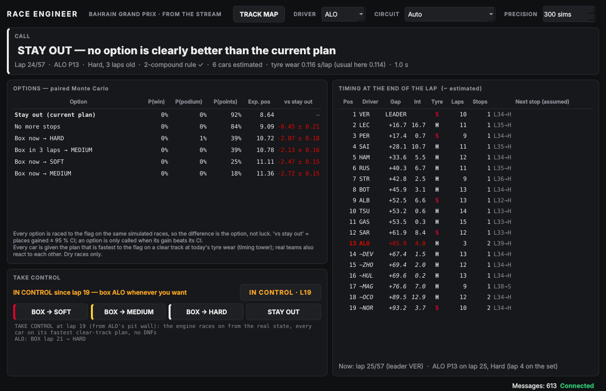
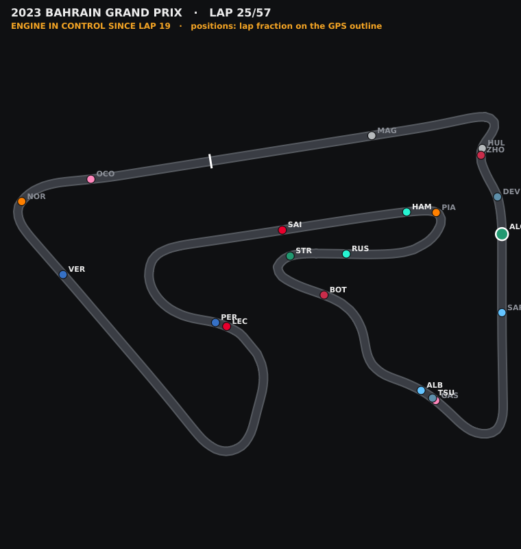
</p>

<details>
<summary><b>Every dashboard tab</b> (click to open)</summary>

| | |
|---|---|
| **Race engineer** — Bahrain 2023, Alonso, lap 20 | **How many stops** — Bahrain |
| 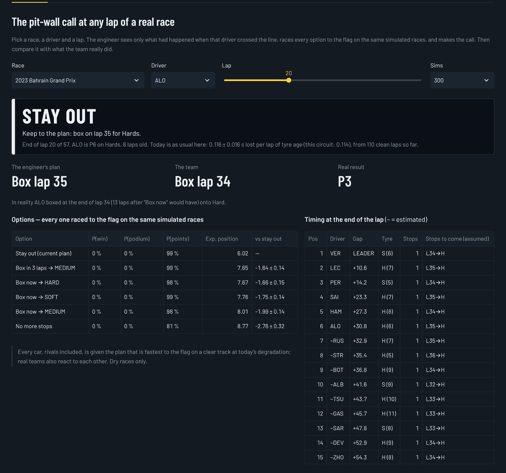 | 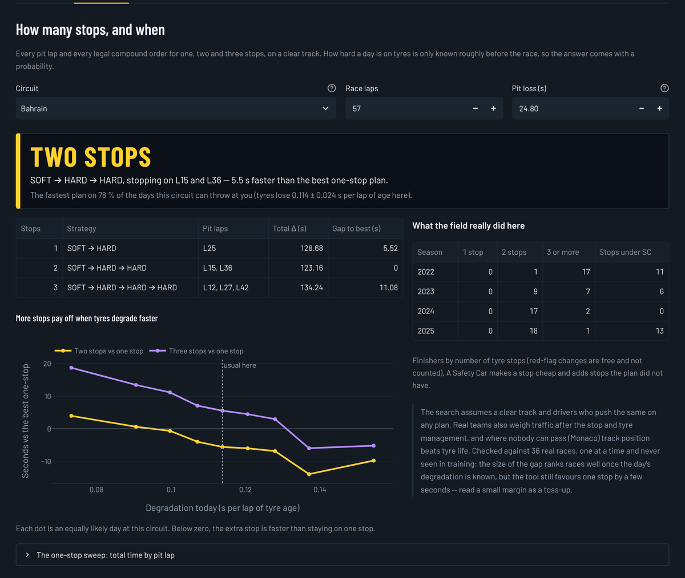 |
| **Undercut** | **Race simulator** — Bahrain 2024 grid, 1,000 races |
| 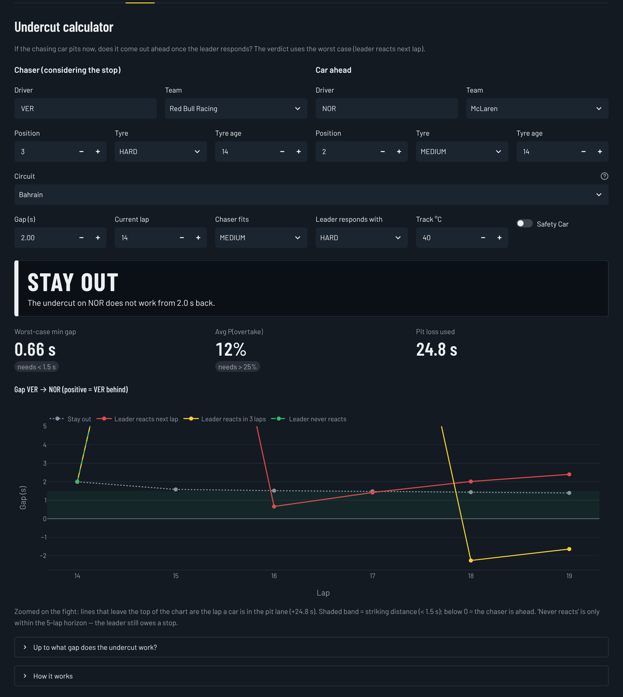 | 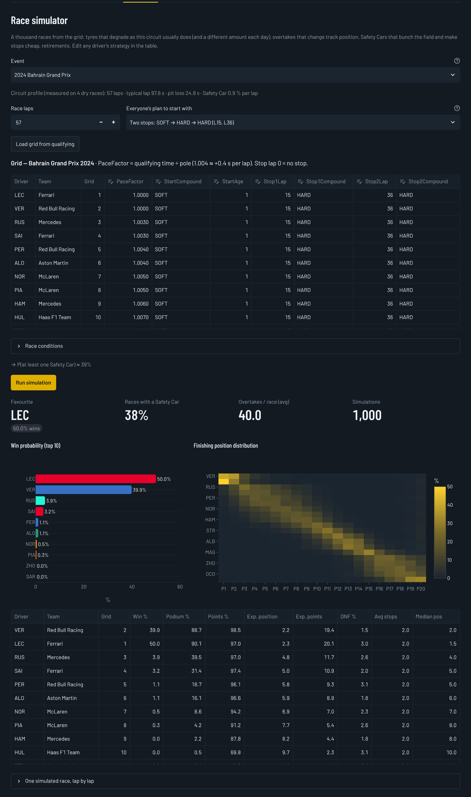 |
| **What-if** — one strategy changed, same random draws | **Qualifying → race** |
| 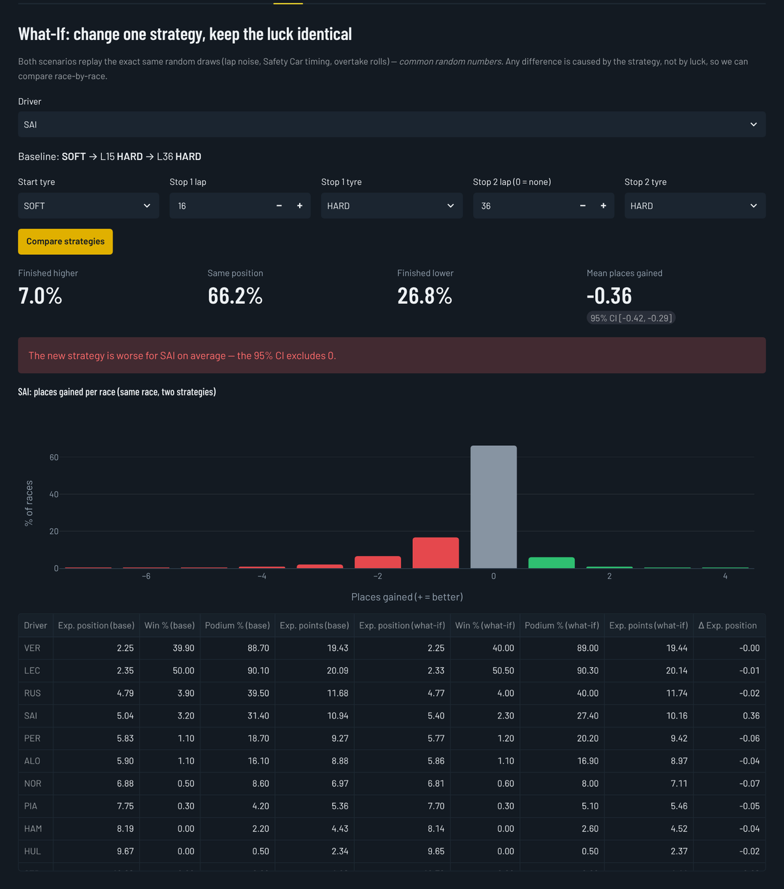 | 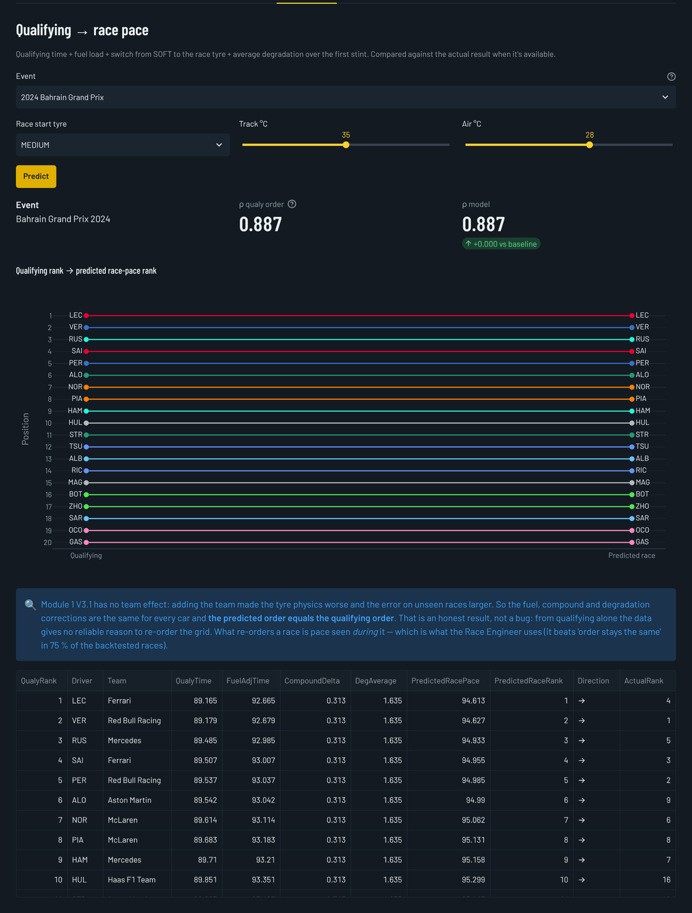 |
| **Telemetry** — Bahrain Q 2024, VER vs LEC | **The real f1-race-replay, offline, with the engineer on its stream** |
| 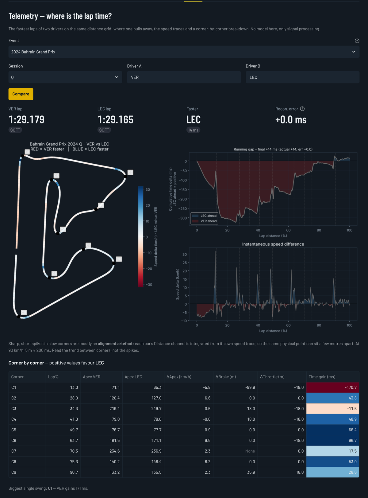 | 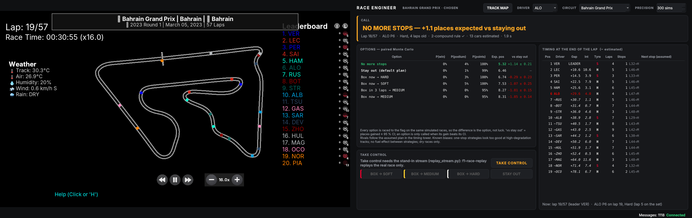 |

</details>

---

## 🛠️ Stack

| Layer | Tools |
|-------|-------|
| Data | FastF1 (2022–2025, cached) → Parquet |
| ML / statistics | XGBoost (monotone constraints), scikit-learn, fixed-effects OLS with clustered CIs, random effects + empirical-Bayes shrinkage, Bayesian updating, UMAP |
| Simulation | NumPy (vectorised over simulations × drivers), paired Monte Carlo / common random numbers |
| Analysis | pandas, SciPy |
| Apps | Streamlit (dashboard), PySide6 (Race Engineer window, track view), TCP JSON-lines (f1-race-replay protocol) |
| Visualisation | Matplotlib, Plotly |
| Testing / CI | pytest, ruff, GitHub Actions, offscreen Qt, executed notebooks (nbclient), Playwright (screenshots) |
| Explainability | SHAP |

---

## 📁 Repository structure

```
f1-data-science/
├── notebooks/                       ← science modules + strategy tools (Colab badges)
├── tools/                           ← reusable logic imported by the app, notebooks and tests
│   ├── shared.py                    ← model loading, feature contracts, constants
│   ├── training.py · train_models.py← Module 1 (V3.2) + Module 2 pipelines, evaluation, sanity gates
│   ├── degradation.py               ← degradation rate per race, circuit prior, live estimate
│   ├── export_cache.py              ← FastF1 cache → Parquet
│   ├── circuit_profiles.py (+ .json)← measured per-circuit constants
│   ├── circuit_outlines.py (+ .json)← GPS outline of each circuit, for drawing the race
│   ├── race_engine.py               ← lap-by-lap engine, LiveRace, state from a real race
│   ├── backtest.py                  ← engine vs reality on 36 races; one stop or two vs the field
│   ├── demo_data.py                 ← builds and reads the demo bundle
│   ├── race_engineer.py             ← live feed → strategy call
│   └── undercut.py · stint_optimizer.py · race_simulator.py · qualy_predictor.py · telemetry_clash.py
├── integrations/f1_race_replay/     ← Race Engineer window, stand-in stream, take control, track view,
│                                       real f1-race-replay offline (run_real_replay, real_payloads)
├── tests/                           ← pytest suite (stand-in models, synthetic races)
├── docs/                            ← screenshots for the READMEs
├── app.py · ui/theme.py             ← Streamlit dashboard and its look (.streamlit/config.toml, static/fonts)
├── demo/                            ← demo bundle: lap data, models, a few sessions (committed, ≈ 4 MB)
├── models/                          ← your trained artefacts (gitignored, see models/README.md)
├── data/                            ← your laps Parquet (gitignored)
├── .github/workflows/tests.yml      ← CI: ruff + pytest on every push
├── pyproject.toml · environment.yml ← project metadata, ruff and pytest config · conda env
├── requirements.txt · requirements-dev.txt
├── LICENSE
└── README.md
```

---

## 📜 License

MIT — see [LICENSE](LICENSE).

## ⚖️ Disclaimer

Educational and fan-made. Not affiliated with Formula 1, the FIA, or any team. Not for betting.

## 🔗 References

- [FastF1](https://github.com/theOehrly/Fast-F1) — the data layer this entire project depends on
- [f1-race-replay](https://github.com/IAmTomShaw/f1-race-replay) — the race replay and telemetry stream the Race Engineer listens to
- [OpenF1 API](https://openf1.org) — live timing data
