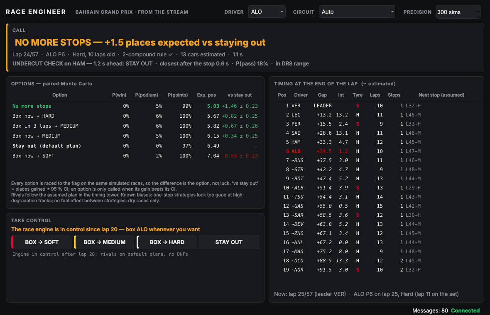

# Race Engineer for f1-race-replay

A pit-wall window that listens to [f1-race-replay](https://github.com/IAmTomShaw/f1-race-replay)'s
telemetry stream and, every time the driver you follow crosses the line, makes the strategy call:
**box now (onto what), box later, or stay out** — with the probabilities behind it.



*2023 Bahrain GP, following Alonso, take-control mode (offscreen render on Linux; on Windows it uses Segoe UI).*

Three pieces:

| File | What it is |
|------|------------|
| `race_engineer_window.py` | The PySide6 window: call, options, timing tower, undercut alert, take-control buttons |
| `replay_stream.py` | A stand-in for f1-race-replay's stream, built from the lap Parquet — same message shape and clocks; plus **take-control** mode |
| `../../tools/race_engineer.py` | The engineer itself (no GUI): payload → call. Used by the window, testable on its own |

## Run it

```bash
conda activate f1
pip install -r integrations/f1_race_replay/requirements.txt      # PySide6
python -m tools.train_models --laps data/laps_2022_2025.parquet   # once, if models/ is empty
```

**Replay a real race** (two terminals, from the repo root):

```bash
python -m integrations.f1_race_replay.replay_stream --race "2023 Bahrain Grand Prix" --speed 30
python -m integrations.f1_race_replay.race_engineer_window --driver ALO
```

**Take control** — the real race until lap 20, then the race engine drives and you call the stops:

```bash
python -m integrations.f1_race_replay.replay_stream --race "2023 Bahrain Grand Prix" --take-control 20 --speed 20
python -m integrations.f1_race_replay.race_engineer_window --driver ALO
```

Use the **BOX → SOFT / MEDIUM / HARD** and **STAY OUT** buttons, or type `box ALO HARD` / `stay ALO`
in the stream's terminal. The other cars follow the same default plan the engineer assumes for them.

**With the real f1-race-replay** (when FastF1 can download position data again — it answers 401 since
October 2026): run `python main.py --telemetry` in that repo, pick a race, then start the window. The
real payload has no event name, so the window guesses the circuit from `circuit_length_m` and the race
distance in laps — pick it in the **CIRCUIT** box when that is ambiguous (Bahrain/Miami, Monza/Suzuka and
Yas Marina/Albert Park share both).

Options: `--circuit "Bahrain Grand Prix"`, `--sims 300` (Monte Carlo races per option; ~1–2 s per call),
`--port`. Stream options: `--start-lap`, `--speed`, `--hz`, `--seed`.

## How a call is made

1. **Snapshot at the end of lap N** — the lap the followed driver has just completed. Cars ahead on the
   road crossed that line already: their real times are used. Cars behind, and lapped cars, have not —
   their line time is **estimated** from their recent pace (plus the rest of the stop if they are on
   their out-lap), or from `rel_dist` in the frame when they are in the last 10 % of the lap — it is
   distance, not time, so it is only trusted near the line. They are marked `~` in the tower. *(The first version took N from the leader and silently
   dropped every car that had not completed lap N yet — "ALO is not running".)*
   - A car in the pit lane (`in_pit`) that has not crossed the line yet is treated as stopping at the end
     of lap N, onto HARD (MEDIUM if it was on HARD) — a guess: the new compound isn't known yet.
   - A stop costs ~23 s, but only ~4 s of it falls on the in-lap; ~19 s is the out-lap (measured on 799
     green-flag stops). The engine charges stops on the in-lap, so a car that pitted at the end of lap N
     gets the rest added now — the tower shows where it will rejoin.
2. **Who is still racing** — a car is out when three other cars have each completed three laps since it
   last crossed the line, or when it has not moved for 20 s (not under a red flag). Counting the field's
   laps instead of seconds keeps everyone in through a red flag. FastF1's generated placeholder rows
   (`fastf1_generated`, e.g. where a car retired) are not line crossings.
3. **Pace** — each driver's median racing lap so far, corrected for fuel and tyre state with Module 1.
4. **Rivals' plans** — one more stop when their tyre reaches the age range the data covers (p90 age per
   compound), or when the two-compound rule is still open; shown in the tower as *Next stop (assumed)*.
5. **Options for our driver** — stay out (default plan), box now onto each legal compound, box in 3 laps,
   no more stops — each raced to the flag **on the same random draws** (paired Monte Carlo, batched in
   one engine run). The headline only calls an option when its gain over staying out beats its 95 % CI.
6. **Undercut alert** — Tool 1 against the car ahead when it is within 3 s.

### No future leakage

f1-race-replay sends the lap times of the **whole race** in every message (`lap_times`, `status_laps`).
The engineer only uses laps whose line time is ≤ the current replay time, cuts track-status periods at
the present, and never looks at the frame of a car beyond where it is now. A test rewrites the future
part of a payload and checks that the call does not change.

The stand-in stream itself has one track status per lap (the Parquet has nothing finer), so its live
`track_status` reports the leader's last *completed* lap: a Safety Car shows up to a lap late, never
early. The real replay knows the exact times.

### Two clocks

`frame.t` is the **replay clock** (0 = race start). In `lap_times`, `end_time_s` / `line_time_s` are the
**FastF1 session clock**; f1-race-replay adds `replay_end_time_s` / `replay_line_time_s` aligned to the
replay clock. The engineer uses the replay-clock fields first (laps rebuilt from frames only carry
`end_time_s`, already on the replay clock). If f1-race-replay could not align its clocks and sends no
`replay_*` fields, the engineer estimates the offset itself (where each car is now vs when it finished its
previous lap). The stand-in stream reproduces both clocks, so all three cases are tested.

### Threads

`StreamClient` (QThread) reads the socket — same protocol and signals as f1-race-replay's
`TelemetryStreamClient`, plus `send()` for commands. `EngineerWorker` (QThread) runs the Monte Carlo on
the **latest** payload only: older ones are dropped, so a 64× replay never builds a queue. The UI
refreshes at 4 Hz whatever the stream rate.

## Take-control mode

From the real state at the end of lap N (`race_engine.state_from_real_race`), `TakeControlFeed` steps
the lap-by-lap engine just ahead of the replay clock and turns each simulated lap into the same payload
fields (`frame`, `lap_times` with `source: "simulated"`, `status_laps`). A **box command** applies to the
lap the car is on (the next one if it is past 85 % of the lap): the engine rewinds to the end of the
previous lap and re-runs it with the **same random draws**, so only the consequences of your call
change — a test checks that boxing mid-lap gives exactly the race you would get by planning it.

## Payload fields

Sent by f1-race-replay and used here: `frame.t`, `frame.drivers[code].{position, lap, rel_dist, dist,
tyre, tyre_life, in_pit}`, `frame.weather`, `track_status`, `session_data.{time_s, total_laps}`,
`lap_times[code][].{lap, time_s, replay_line_time_s, replay_end_time_s, end_time_s, tyre, tyre_life,
is_pit_entry, is_out_lap, fastf1_generated}`, `status_laps`, `circuit_length_m`. Tyre ints: SOFT 0,
MEDIUM 1, HARD 2, INTERMEDIATE 3, WET 4.

Not in the real payload: `session_info: {event_name, year}` (proposed upstream — see
`UPSTREAM_PROPOSAL.md`) and `take_control` (stand-in stream only). Positions in the stand-in stream are
schematic (constant speed within each lap, cars on a circle): the Parquet has lap times, not GPS.

## Tests

```bash
python -m pytest -q tests/test_race_engineer.py tests/test_replay_stream.py tests/test_race_engineer_window.py
```

The window test runs offscreen (`QT_QPA_PLATFORM=offscreen`) through a real socket and a real worker
thread, and is skipped if PySide6 is not installed.

## Limitations

- The engine's known biases apply: per-circuit degradation is compressed, so **one-stop strategies look
  too good at abrasive tracks** ("NO MORE STOPS" early in Bahrain); no fuel effect between strategies
  (mirror strategies cost the same); fresh MEDIUM vs HARD are hard to tell apart.
- Rivals follow a simple default plan, not their real strategy — the call is "given what we assume
  they do".
- Dry races only: on INTERMEDIATE / WET the window says so and makes no call.
- Line times of cars behind are estimates (`python -m integrations.f1_race_replay.estimate_accuracy`,
  2,736 estimates in Bahrain 2023, Monza 2024 and Monaco 2025, through the stand-in stream): median
  error **0.40 s** (90 % under 2.9 s) when that car does not stop in the lap, 0.02 s within 10 s of the
  line, 4.7 s when it does stop (an in-lap's stop is still in the future). Using `rel_dist` all round the
  lap would look better here (0.18 s), but only because the stand-in's `rel_dist` is built from the
  lap's real duration; accuracy with the real, distance-based `rel_dist` is not measured.
- Take-control: no DNFs and no new weather.
- Model era: 2022–2025 cars and rules; 2026 is excluded on purpose.
